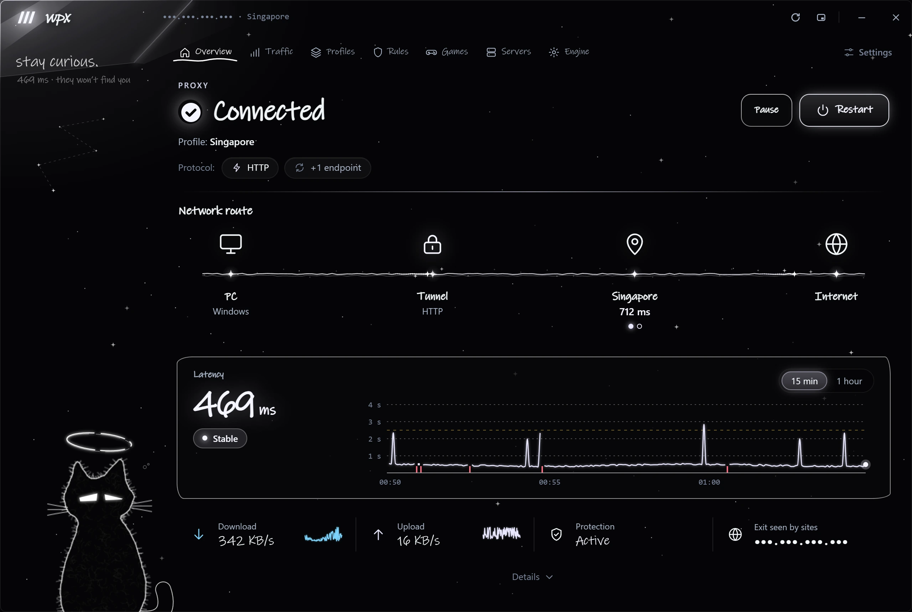
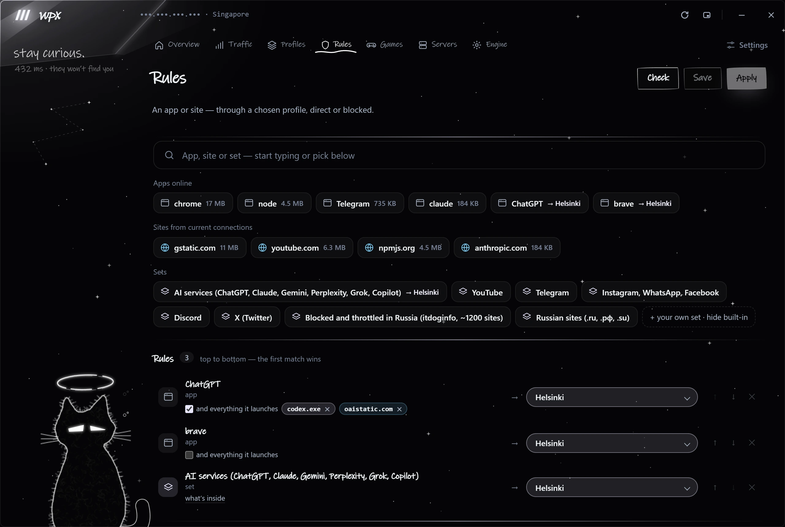
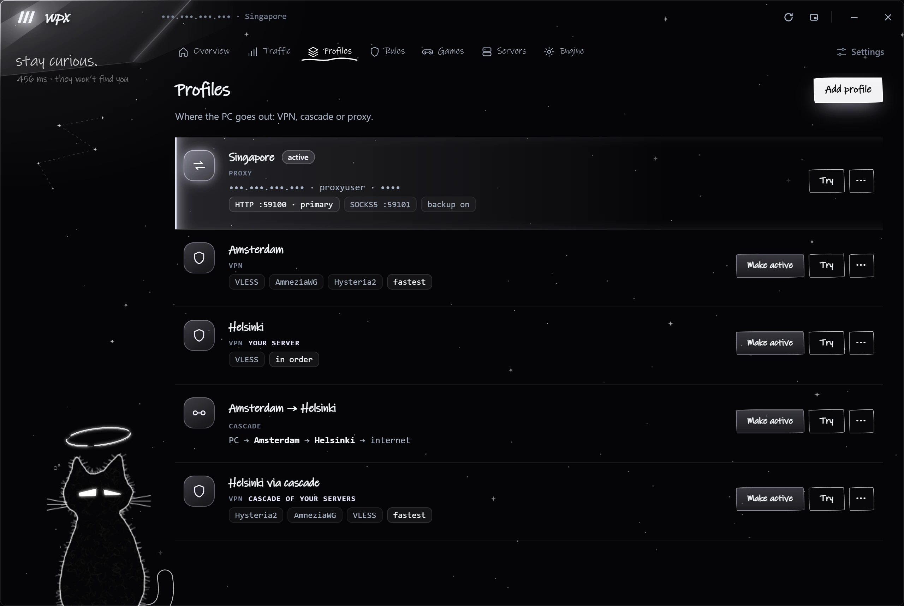
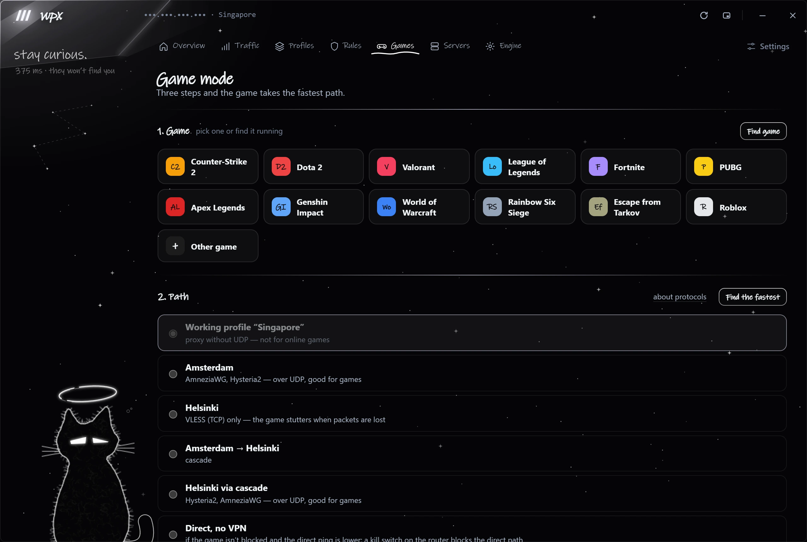
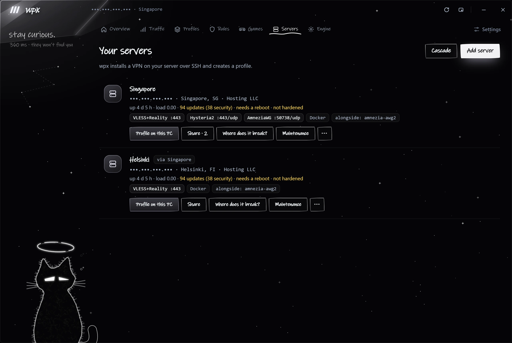
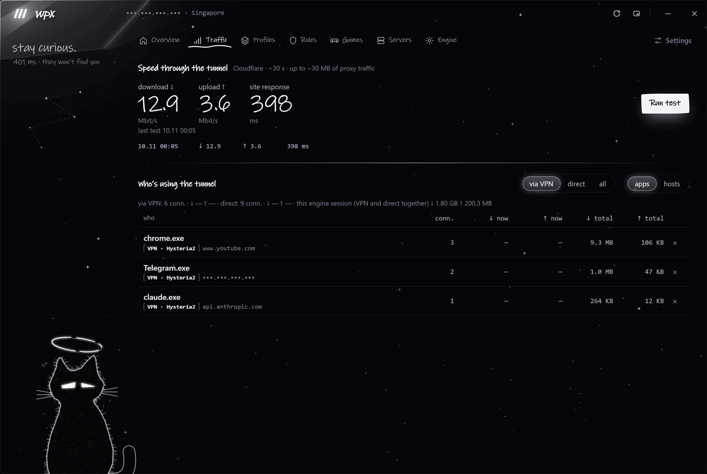
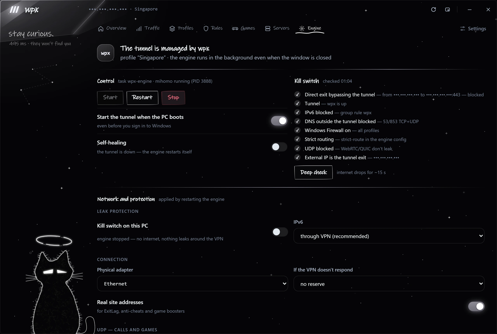
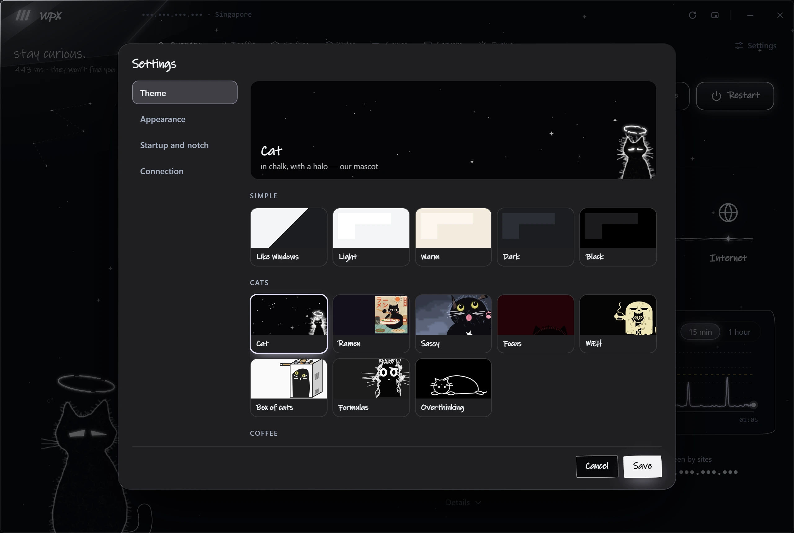
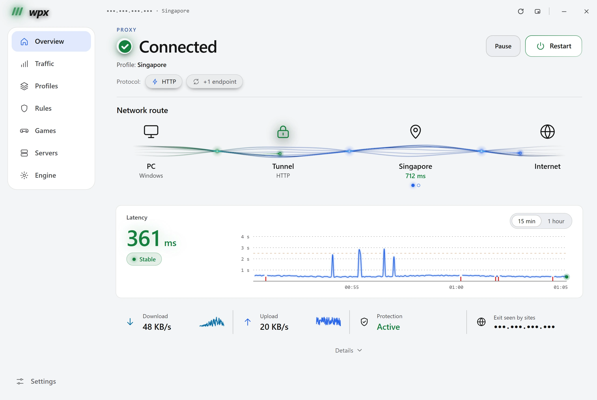

# wpx

**A tunnel manager for your whole PC — and for your own VPN servers.**

wpx keeps every connection of the computer behind a tunnel ([mihomo](https://github.com/MetaCubeX/mihomo) in TUN mode),
guards it with a kill switch, and changes the setup only through transactions that roll back by themselves if the
tunnel does not come up. It also deploys and maintains VPN servers on your own VPS over SSH — no panel, no agent on
the server.

Windows 10/11 and Linux (x86-64). Interface in Russian and English.

> **Status: beta.** Windows is the main platform; Linux support is experimental. Installers are not code-signed yet —
> see [Install](#install).

[Русская версия](README.ru.md)

---

## Screenshots

<table>
  <tr>
    <td align="center"><a href="docs/screenshots/en/overview.webp"></a><br><sub><b>Overview</b> — route map, latency, protection</sub></td>
    <td align="center"><a href="docs/screenshots/en/rules.webp"></a><br><sub><b>Rules</b> — apps, sites and sets → any profile, direct or blocked</sub></td>
    <td align="center"><a href="docs/screenshots/en/profiles.webp"></a><br><sub><b>Profiles</b> — VPN, your own servers, cascades, proxies</sub></td>
    <td align="center"><a href="docs/screenshots/en/games.webp"></a><br><sub><b>Game mode</b> — the fastest path for a game and its login</sub></td>
    <td align="center"><a href="docs/screenshots/en/servers.webp"></a><br><sub><b>Your servers</b> — VPN on your VPS over SSH</sub></td>
    <td align="center"><a href="docs/screenshots/en/traffic.webp"></a><br><sub><b>Traffic</b> — speed test, who uses the tunnel</sub></td>
    <td align="center"><a href="docs/screenshots/en/engine.webp"></a><br><sub><b>Engine</b> — kill switch, network and leak protection</sub></td>
    <td align="center"><a href="docs/screenshots/en/themes.webp"></a><br><sub><b>Themes</b> — simple ones and 40+ animated</sub></td>
    <td align="center"><a href="docs/screenshots/en/light.webp"></a><br><sub><b>Light theme</b> — the same overview, plain and light</sub></td>
  </tr>
</table>

<p align="center"><sub>← scroll sideways: Shift + mouse wheel, touchpad or swipe · click a screenshot to open it full size →</sub></p>

## Features

**Tunnel for the whole PC**
- One engine (mihomo, TUN, strict route) for all programs; installed and updated by wpx. DNS gives programs real
  addresses (game boosters like ExitLag and anti-cheats work); a site's address is looked up the same way as its
  traffic goes — through the tunnel or directly. Fake-IP is an option.
- Kill switch: Windows Firewall or nftables on Linux, plus ready-made rules for your router.
- Every change is a transaction: config checked with `mihomo -t` → one admin prompt → a system-level rollback guard →
  change → tunnel check → rollback on failure, even if wpx itself crashes.
- Watchdog, start before sign-in, IPv6 through the tunnel or blocked, UDP/QUIC policy.

**Profiles**
- Import links: VLESS + Reality, XHTTP + Reality, Hysteria2 (with port hopping), Trojan, Shadowsocks, AmneziaWG configs,
  `vpn://` from AmneziaVPN, HTTP(S) and SOCKS5 proxies.
- Cascades (entry → exit), multi-hop routes, a reserve profile that takes over automatically, fixed exit IPs.
- Sandbox checks of every endpoint before anything changes on the PC; trial run of a profile without touching the system.

**Rules**
- Per app, per site, or ready-made sets (AI services, YouTube, Telegram, Discord, …) → through any profile, directly, or blocked.
- *"…and everything it launches"*: wpx finds an app's helper processes (e.g. Codex started by ChatGPT) and the sites its
  shared helpers open, and routes them the same way on the fly — without restarting the engine.
- Game mode with *login redirect*: the game, its launcher and everything started from the game folder go through the fastest path.
- Drag a game shortcut, an `.exe`, a folder or a link onto the window or the notch.

**Your own servers (SSH)**
- Deploy VLESS + Reality, Hysteria2, AmneziaWG, XHTTP + Reality and MTProxy (pinned versions, checksums / image digests).
- Server firewall and hardening, cascades between your servers, one-click move to a new VPS, core updates with rollback.
- Share access: personal keys for guests with expiry and QR codes; guests are isolated from the server's internal network.
- "Where does it break": PC → SSH → services → ports → the internet, step by step.

**Seeing what happens**
- Live route map, latency pulse, who uses the tunnel, speed test, leak test (IP, direct exit, IPv6, DNS, WebRTC),
  a support report with addresses masked.
- The *notch*: a small capsule at any screen edge or corner with status and quick actions.
- 40+ animated themes, streamer mode (hides IPs, links, keys and QR codes), automatic updates.

## Install

Download the latest release from **[GitHub Releases](https://github.com/qjcky/wpx/releases)**:

| System | File | Notes |
|---|---|---|
| Windows 10/11 x64 | `wpx_<version>_x64-setup.exe` | per-user install, no admin needed to install |
| Debian / Ubuntu x64 | `wpx_<version>_amd64.deb` | `sudo apt install ./wpx_<version>_amd64.deb` |
| Other Linux x64 | `wpx_<version>_amd64.AppImage` | `chmod +x` and run; needs polkit, nftables, systemd, curl |

**Windows warns about the installer** ("Windows protected your PC") because it is not code-signed yet: click
*More info → Run anyway*. Check the file first: its SHA-256 must match `SHA256SUMS-Windows.txt` in the same release
(`Get-FileHash .\wpx_<version>_x64-setup.exe`).

First run: add a profile (paste links, or deploy your own server on the **Servers** tab) → **Install engine**.

### What wpx changes in the system

After one administrator prompt:

- the engine (mihomo shipped with wpx) goes to `C:\ProgramData\wpx\engine` (Windows) or `/opt/wpx/engine` (Linux);
- it runs as a SYSTEM scheduled task `wpx-engine` (Windows) or a systemd service (Linux), optionally at boot;
- firewall rules of the group `wpx`: direct DNS and IPv6 past the tunnel are blocked while the engine runs; with the
  kill switch on, everything except the tunnel and the local network is blocked;
- optional: the watchdog task (self-healing), and a boot task that lifts the DNS/IPv6 blocks when the engine does
  not start at boot.

**Engine → Remove engine** undoes all of it (and restores the previous firewall defaults). wpx itself is a normal
per-user app: uninstall it from *Settings → Apps* (Windows) or your package manager (Linux).

## Build from source

Requirements:
- [Node.js](https://nodejs.org) 20+ and [Rust](https://rustup.rs) (stable).
- Windows: Microsoft C++ Build Tools, WebView2 (preinstalled on Windows 10/11).
- Linux (Debian/Ubuntu):
  `sudo apt install build-essential pkg-config libssl-dev libwebkit2gtk-4.1-dev libgtk-3-dev libayatana-appindicator3-dev librsvg2-dev libxdo-dev`

```bash
npm install            # also downloads mihomo for your platform and verifies its SHA-256
npm run tauri dev      # run in development mode
npm run tauri build    # installer: src-tauri/target/release/bundle/
```

**Lab build** — a safe build for development: its own data folder, no system changes, no autostart, no notifications.
It can run next to an installed wpx:

```bash
npm run lab            # → src-tauri/target/release/wpx-lab(.exe)
```

**Linux packages from any OS** (Docker):

```bash
docker build -t wpx-linux -f scripts/docker/linux.Dockerfile scripts/docker
docker run --rm -v "$PWD:/host:ro" -v "$PWD/dist-linux:/out" wpx-linux
```

**Checks**:

```bash
npm run typecheck
cd src-tauri && cargo test --lib
```

## Command line

The same binary has a few diagnostic modes (they print JSON or text and exit):

| Command | What it does |
|---|---|
| `wpx --probe` | one round of all checks |
| `wpx --dry-run` | build the working profile's config and check it with `mihomo -t`, change nothing |
| `wpx --probe-links <file>` | check endpoints from a file in a sandbox (no TUN, no admin rights) |
| `wpx --trial <profile>` | trial run of a profile without TUN |
| `wpx --leaks`, `wpx --report` | leak test; support report |
| `wpx --server …` | manage your servers (see `servers::cli`) |

## Project layout

```
src/                 frontend (TypeScript, no framework)
  core/              bridge to Rust, types, i18n, streamer mode, drag-and-drop, helpers
  app/               pages: profiles, engine, rules, servers, games, traffic, diagnostics, route
  notch/             the notch window
  theme/             animated themes (canvas scenes)
  styles/  locales/  CSS and translations (one JSON per language)
src-tauri/           backend (Rust, Tauri 2)
  src/app/           commands for the UI, tray, notch, updates, games
  src/engine/        mihomo config builder, transactions (ops/windows.rs, ops/linux.rs), API, sandbox
  src/monitor/       background checks, diagnostics, speed test, history
  src/profiles/      profiles and link formats
  src/servers/       your own servers over SSH
  src/platform/      Windows / Linux differences
scripts/             fetch-mihomo.mjs (pinned engine download), Docker build, make-icon.py (app icons from the tray cat)
docs/                architecture, security, Linux notes, releasing
```

More: [architecture](docs/architecture.md) · [security](docs/security.md) · [Linux](docs/linux.md) · [releasing](docs/releasing.md).

## Adding a language

Copy `src/locales/en.json` to `src/locales/<code>.json`, set `"name"`, translate the values. Exact strings go to
`"exact"`, strings with variable parts to `"patterns"` (`{}` marks a variable). The new language appears in Settings.

## License

wpx is free software: [GPL-3.0-or-later](LICENSE). You may use, study, change and share it; changed versions you
distribute must stay under the same license with their source code. Bundled and deployed third-party software keeps
its own licenses — see [THIRD_PARTY_NOTICES.md](THIRD_PARTY_NOTICES.md).

The name *wpx* and its logo are not covered by the license: if you distribute a changed version, please give it a
different name. Contributing: [CONTRIBUTING.md](CONTRIBUTING.md). Security: [SECURITY.md](SECURITY.md).
