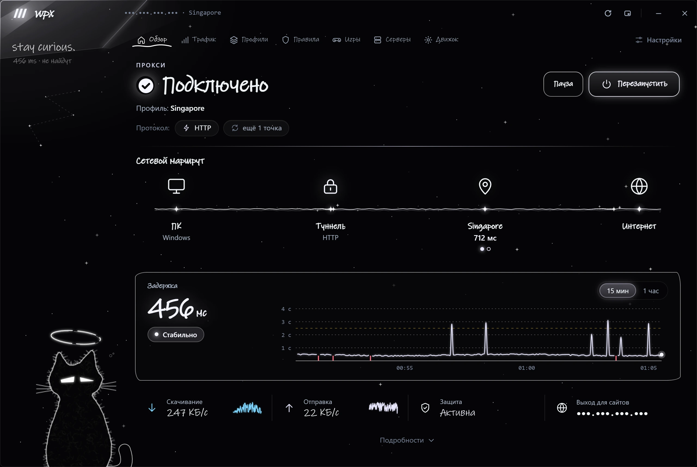
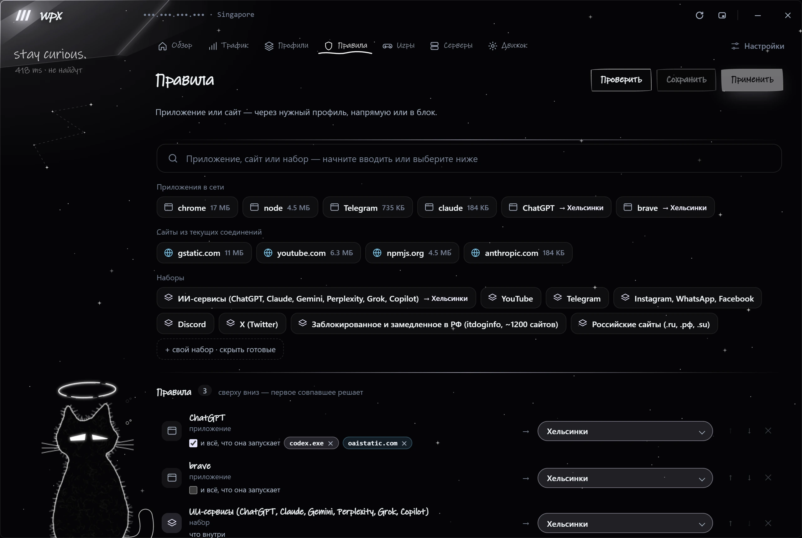
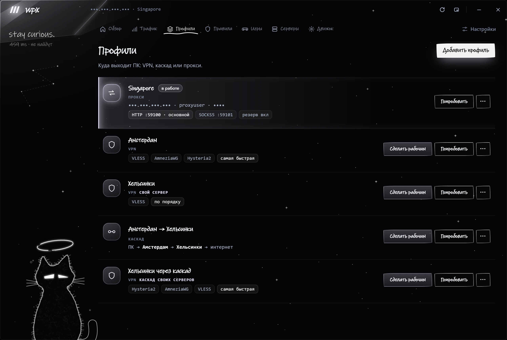
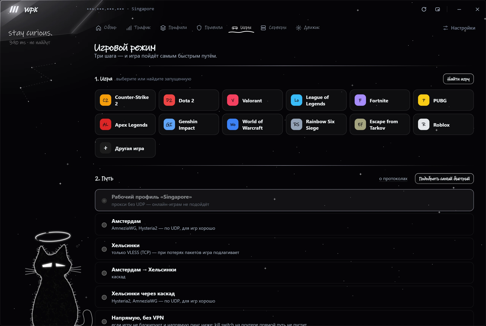
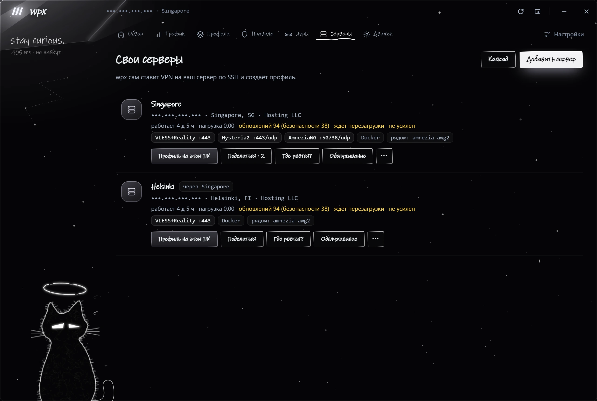
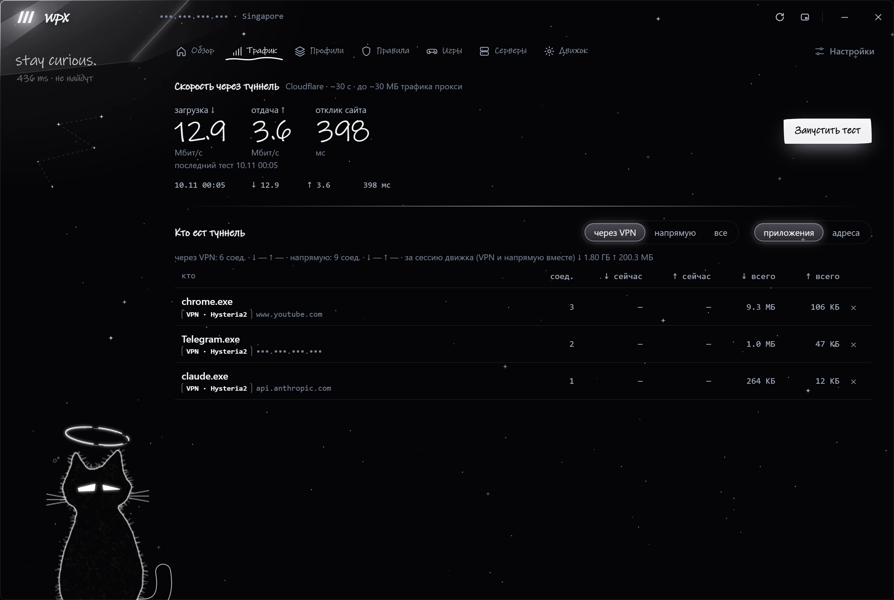
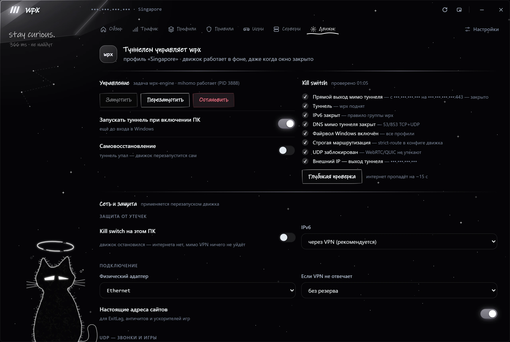
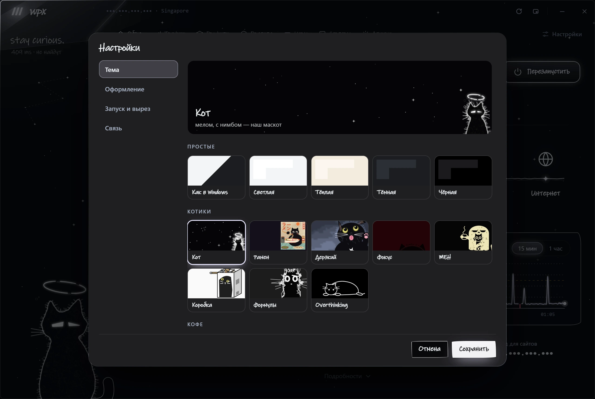
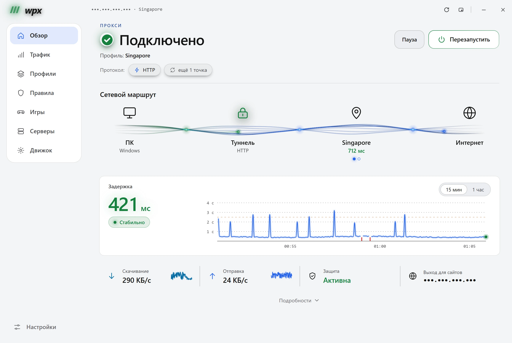

# wpx

**VPN-клиент для всего ПК — и менеджер ваших собственных VPN-серверов.**

wpx пускает все соединения компьютера через туннель ([mihomo](https://github.com/MetaCubeX/mihomo) / Clash Meta в режиме
TUN), держит kill switch и меняет систему только транзакциями: если туннель не поднялся, всё возвращается само.
Раздельное туннелирование по приложениям и сайтам: каждую программу или сайт — через нужный профиль (VPN, прокси),
напрямую или в блок. Ещё wpx разворачивает и обслуживает VPN на ваших собственных VPS по SSH — без панели и без агента
на сервере.

Протоколы: **VLESS + Reality**, **XHTTP + Reality**, **Hysteria2**, **AmneziaWG** (WireGuard с обфускацией), Trojan,
Shadowsocks, MTProxy, HTTP(S)- и SOCKS5-прокси; каскады (multi-hop) и маршруты с автоматическим переключением.

Windows 10/11 и Linux (x86-64). Интерфейс на русском и английском. Бесплатно и с открытым кодом (GPL-3.0).

> **Статус: бета.** Основная платформа — Windows, поддержка Linux экспериментальная. Установщики пока без цифровой
> подписи — см. [Установка](#установка).

[English version](README.md)

---

## Скриншоты

<table>
  <tr>
    <td align="center"><a href="docs/screenshots/ru/overview.webp"></a><br><sub><b>Обзор</b> — маршрут, задержка, защита</sub></td>
    <td align="center"><a href="docs/screenshots/ru/rules.webp"></a><br><sub><b>Правила</b> — приложения, сайты и наборы → любой профиль, напрямую или в блок</sub></td>
    <td align="center"><a href="docs/screenshots/ru/profiles.webp"></a><br><sub><b>Профили</b> — VPN, свои серверы, каскады, прокси</sub></td>
    <td align="center"><a href="docs/screenshots/ru/games.webp"></a><br><sub><b>Игровой режим</b> — самый быстрый путь для игры и её входа</sub></td>
    <td align="center"><a href="docs/screenshots/ru/servers.webp"></a><br><sub><b>Свои серверы</b> — VPN на вашем VPS по SSH</sub></td>
    <td align="center"><a href="docs/screenshots/ru/traffic.webp"></a><br><sub><b>Трафик</b> — тест скорости, кто ест туннель</sub></td>
    <td align="center"><a href="docs/screenshots/ru/engine.webp"></a><br><sub><b>Движок</b> — kill switch, сеть и защита от утечек</sub></td>
    <td align="center"><a href="docs/screenshots/ru/themes.webp"></a><br><sub><b>Темы</b> — простые и 40+ живых</sub></td>
    <td align="center"><a href="docs/screenshots/ru/light.webp"></a><br><sub><b>Светлая тема</b> — тот же обзор — просто и светло</sub></td>
  </tr>
</table>

<p align="center"><sub>← листайте вбок: Shift + колесо мыши, тачпад или свайп · клик по скриншоту — во весь размер →</sub></p>

## Возможности

**Туннель для всего ПК**
- Один движок (mihomo, TUN, strict-route, DNS через туннель) для всех программ; wpx сам его ставит и обновляет.
- Kill switch: брандмауэр Windows или nftables в Linux, плюс готовые правила для роутера.
- Любое изменение — транзакция: проверка конфига `mihomo -t` → одно окно прав администратора → страховка от имени
  системы → изменение → проверка туннеля → откат при неудаче, даже если сам wpx упадёт.
- Сторож, запуск до входа в систему, IPv6 через туннель или закрыт, правила для UDP/QUIC.

**Профили**
- Ссылки: VLESS + Reality, XHTTP + Reality, Hysteria2 (со сменой портов), Trojan, Shadowsocks, конфиги AmneziaWG,
  `vpn://` из AmneziaVPN, HTTP(S)- и SOCKS5-прокси.
- Каскады (вход → выход), маршруты из нескольких звеньев, резервный профиль, постоянный IP выхода.
- Проверка каждой точки в песочнице до любых изменений на ПК; пробный запуск профиля, не трогая систему.

**Правила**
- Приложение, сайт или готовый набор (ИИ-сервисы, YouTube, Telegram, Discord…) → через любой профиль, напрямую или блок.
- «…и всё, что она запускает»: wpx сам находит помощников программы (например, Codex у ChatGPT) и сайты её общих
  помощников и ведёт их тем же путём — на лету, без перезапуска движка.
- Игровой режим с перенаправлением входа: игра, лаунчер и всё из папки игры — самым быстрым путём.
- Ярлык игры, exe, папку или ссылку можно просто перетащить на окно или на вырез.

**Свои серверы (SSH)**
- VLESS + Reality, Hysteria2, AmneziaWG, XHTTP + Reality и MTProxy (закреплённые версии, контрольные суммы и хэши образов).
- Файрвол и защита сервера, каскады между своими серверами, переезд на новый VPS в один клик, обновление ядер с откатом.
- «Поделиться доступом»: личные ключи для гостей со сроком и QR-кодом; гостям закрыта внутренняя сеть сервера.
- «Где рвётся»: ПК → SSH → службы → порты → интернет, по шагам.

**Видно, что происходит**
- Карта маршрута, пульс задержки, кто ест туннель, тест скорости, проверка утечек (IP, прямой выход, IPv6, DNS, WebRTC),
  отчёт для поддержки со скрытыми адресами.
- Вырез — капсула у любого края или угла экрана: состояние и быстрые действия.
- 40+ живых тем, режим стримера (прячет IP, ссылки, ключи и QR-коды), автообновление.

## Установка

Скачайте последнюю версию на **[GitHub Releases](https://github.com/qjcky/wpx/releases)**:

| Система | Файл | Заметки |
|---|---|---|
| Windows 10/11 x64 | `wpx_<версия>_x64-setup.exe` | ставится для пользователя, права администратора не нужны |
| Debian / Ubuntu x64 | `wpx_<версия>_amd64.deb` | `sudo apt install ./wpx_<версия>_amd64.deb` |
| Другой Linux x64 | `wpx_<версия>_amd64.AppImage` | `chmod +x` и запуск; нужны polkit, nftables, systemd, curl |

**Windows предупредит об установщике** («Система Windows защитила ваш компьютер»): цифровой подписи у него пока нет.
Нажмите *Подробнее → Выполнить в любом случае*. Сначала проверьте файл: его SHA-256 должен совпасть с
`SHA256SUMS-Windows.txt` в том же релизе (`Get-FileHash .\wpx_<версия>_x64-setup.exe`).

Первый запуск: добавьте профиль (вставьте ссылки или разверните свой сервер на вкладке «Серверы») → **«Установить движок»**.

### Что wpx меняет в системе

После одного подтверждения прав администратора:

- движок (mihomo из поставки wpx) ставится в `C:\ProgramData\wpx\engine` (Windows) или `/opt/wpx/engine` (Linux);
- он работает как задача планировщика `wpx-engine` от имени SYSTEM (Windows) или служба systemd (Linux), по желанию —
  с запуском при включении ПК;
- правила файрвола группы `wpx`: пока движок работает, закрыты прямой DNS и IPv6 мимо туннеля; с kill switch закрыто
  всё, кроме туннеля и локальной сети;
- по желанию: задача самовосстановления (wpx-watchdog) и задача при загрузке, которая снимает блоки DNS и IPv6, если
  движок не запускается вместе с ПК.

**«Движок» → «Удалить движок»** убирает всё это (и возвращает прежние настройки файрвола). Сам wpx — обычное
приложение пользователя: удаляется в *Параметры → Приложения* (Windows) или пакетным менеджером (Linux).

## Сборка из исходников

Нужно:
- [Node.js](https://nodejs.org) 20+ и [Rust](https://rustup.rs) (stable).
- Windows: Microsoft C++ Build Tools, WebView2 (в Windows 10/11 уже есть).
- Linux (Debian/Ubuntu):
  `sudo apt install build-essential pkg-config libssl-dev libwebkit2gtk-4.1-dev libgtk-3-dev libayatana-appindicator3-dev librsvg2-dev libxdo-dev`

```bash
npm install            # заодно скачает mihomo под вашу систему и сверит SHA-256
npm run tauri dev      # запуск для разработки
npm run tauri build    # установщик: src-tauri/target/release/bundle/
```

**Лабораторная сборка** — безопасная для разработки: своя папка данных, без изменений в системе, без автозапуска
и уведомлений. Работает рядом с установленным wpx:

```bash
npm run lab            # → src-tauri/target/release/wpx-lab(.exe)
```

**Пакеты для Linux из любой системы** (Docker):

```bash
docker build -t wpx-linux -f scripts/docker/linux.Dockerfile scripts/docker
docker run --rm -v "$PWD:/host:ro" -v "$PWD/dist-linux:/out" wpx-linux
```

**Проверки**:

```bash
npm run typecheck
cd src-tauri && cargo test --lib
```

## Командная строка

| Команда | Что делает |
|---|---|
| `wpx --probe` | один прогон всех проверок |
| `wpx --dry-run` | собрать конфиг рабочего профиля и проверить `mihomo -t`, ничего не меняя |
| `wpx --probe-links <файл>` | проверить точки из файла в песочнице (без TUN и прав) |
| `wpx --trial <профиль>` | пробный запуск профиля без TUN |
| `wpx --leaks`, `wpx --report` | проверка утечек; отчёт для поддержки |
| `wpx --server …` | свои серверы (см. `servers::cli`) |

## Устройство проекта

```
src/                 фронтенд (TypeScript, без фреймворков)
  core/              мост к Rust, типы, перевод, режим стримера, перетаскивание, помощники
  app/               страницы: профили, движок, правила, серверы, игры, трафик, диагностика, маршрут
  notch/             окно выреза
  theme/             живые темы (сцены на canvas)
  styles/  locales/  стили и переводы (один JSON на язык)
src-tauri/           бэкенд (Rust, Tauri 2)
  src/app/           команды окна, трей, вырез, обновления, игры
  src/engine/        сборка конфига mihomo, транзакции (ops/windows.rs, ops/linux.rs), API, песочница
  src/monitor/       фоновые проверки, диагностика, тест скорости, история
  src/profiles/      профили и форматы ссылок
  src/servers/       свои серверы по SSH
  src/platform/      различия Windows и Linux
scripts/             fetch-mihomo.mjs (загрузка движка с проверкой), сборка в Docker, make-icon.py (значки из кота в трее)
docs/                устройство, безопасность, Linux, выпуск версий
```

Подробнее: [устройство](docs/architecture.md) · [безопасность](docs/security.md) · [Linux](docs/linux.md) · [выпуск версий](docs/releasing.md).

## Новый язык

Скопируйте `src/locales/en.json` в `src/locales/<код>.json`, впишите `"name"` и переведите значения. Точные строки —
в `"exact"`, строки с подстановками — в `"patterns"` (`{}` — подставляемая часть). Язык появится в настройках.

## Лицензия

wpx — свободное ПО: [GPL-3.0-or-later](LICENSE). Его можно использовать, изучать, менять и распространять; изменённые
версии при распространении остаются под той же лицензией и с исходным кодом. У стороннего ПО, которое идёт в поставке
или ставится на сервер, — свои лицензии, см. [THIRD_PARTY_NOTICES.md](THIRD_PARTY_NOTICES.md).

Имя *wpx* и логотип лицензией не покрываются: изменённую версию, пожалуйста, распространяйте под другим именем.
Участие в разработке — [CONTRIBUTING.md](CONTRIBUTING.md), безопасность — [SECURITY.md](SECURITY.md).
